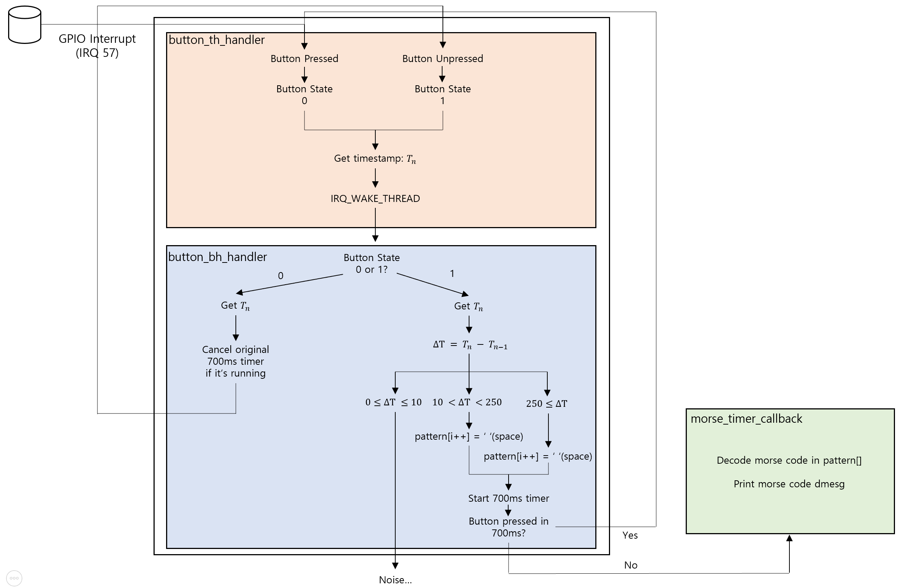
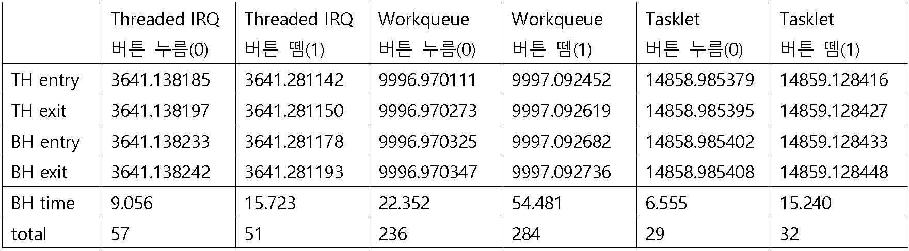
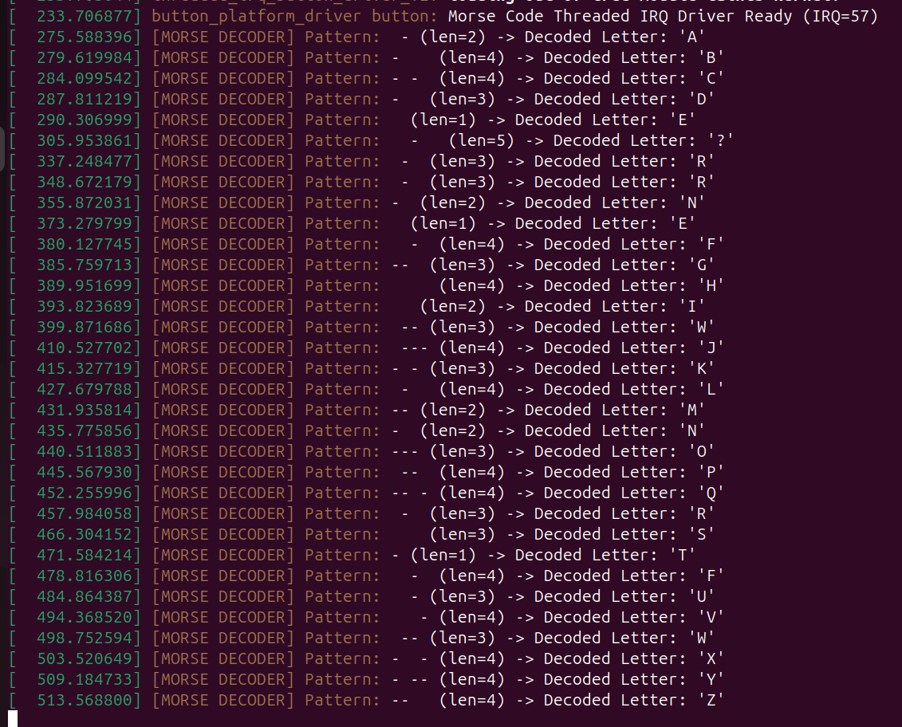
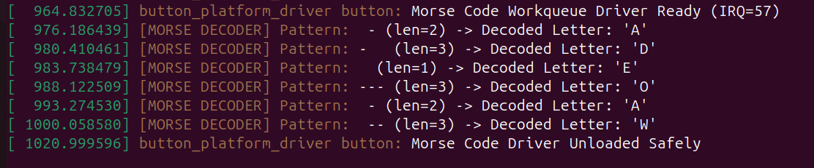
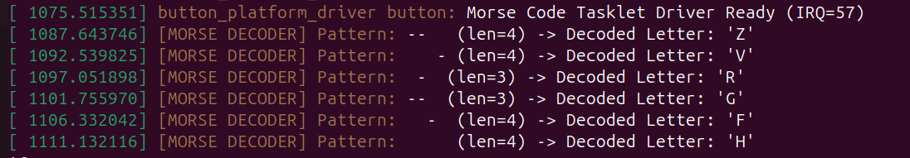

# kernel-interrupt-latency-test
A Linux device driver that prints Morse code via button interrupts, benchmarking the execution time of Threaded IRQ, Workqueue, and Tasklet.

[An In-depth Analysis of the Linux Kernel's Bottom-Half Interrupt Processing Mechanism](./docs/bottom_half_theory.md)

## 1. Overview & Hardware Setup
- Raspberry Pi 4B
- Linux Kernel Version: 6.12.75 (6.12.XX)
- Trace Tool: ftrace function_graph
- Hardware Setup
  - GND: 6th pin or 9th pin
  - VCC / 3.3V: 1th pin
  - GPIO Signal: Raspberry Pi 4B GPIO 17 (40th pin)

- IRQ 57
  - BCM2835 SoC의 GPIO 핀 입력이 커널 내부에서 매핑된 인터럽트 번호로, `request_threaded_irq`를 통해 Top-Half 핸들러가 바인딩되어 버튼 입력을 비동기적으로 감지

## 2. System Architecture & Event Flow

- Top-Half (button_th_handler)
  - 하드웨어 인터럽트 컨텍스트에서 `gpiod_get_value()`로 핀 상태 확인 및 `ktime_get()` 타임스탬프만 즉각 기록
 
- Bottom-Half (button_bh_handler)
  - 10ms 디바운싱(노이즈 필터링), 250ms 기준 점(.)과 선(-) 판별 및 `mod_timer()`를 통한 700ms 타임아웃 갱신
 
- Timer Callback (morse_timer_callback)
  - 700ms 무입력 시 `decode_morse()` 호출 및 `dmesg` 출력

## 3. Quantitative Benchmark Results

- TH Entry/Exit & BH Entry/Exit Unit of Time
  - [seconds].[milliseconds]

### 3-1. In-Depth Latency Analysis

- **Top-Half 내 메커니즘에 따른 오버헤드 격차**
  - Tasklet 및 Threaded IRQ
    - Tasklet과 Threaded IRQ는 TH 실행 완료까지 각각 약 11 ~ 16 µs, 8 ~ 12 µs의 매우 짧은 시간만을 소모.
    - Workqueue의 스케줄링 개입 오버헤드. Workqueue는 TH(`button_th_handler`) 내부에서 `queue_work_on()` -> `try_to_wake_up()` -> `enqueue_task_fair()` 순으로 커널 스케줄러 함수를 연쇄 호출. 이 과정에서 CFS(Completely Fair Scheduler) 런큐에 워커 스레드를 삽입. TH 구간에서만 162 ~ 167 µs의 높은 오버헤드가 발생. TH 내부에서 CFS 런큐 등록과 함께 `resched_curr()`를 통한 선점 플래그인 `TIF_NEED_RESCHED` 설정이 완료되며, 실제 스케줄링(`schedule()`)을 통한 워커 스레드로의 Context Switch은 인터럽트 핸들러가 종료되고 복귀하는 시점에 발생
   
- **Interrupt vs Process Context 차이와 TH에서 BH 전환 지연**
    - Tasklet은 하드웨어 IRQ가 끝난 직후 커널이 인터럽트 컨텍스트(SoftIRQ)를 유지한 채 곧바로 BH를 실행하므로, TH 종료부터 BH 진입까지의 지연 시간이 6 ~ 7 µs로 기록.
    - Threaded IRQ와 Workqueue는 BH가 별도의 커널 스레드(irq/57-... 또는 kworker)라는 Process Context에서 동작. 따라서 TH 종료 후 스케줄러가 개입해 <idle> 상태에서 해당 커널 스레드로 Context Switch을 수행해야 하므로 각각 28 ~ 36 µs(Threaded IRQ), 52 ~ 63µs(Workqueue)의 스케줄링 지연이 발생.
 
- **스케줄링 정책(RT vs CFS)에 따른 Threaded IRQ와 Workqueue의 성능 차이**
    - 같은 Process Context 기반임에도 Threaded IRQ(총 51 ~ 57 µs)가 Workqueue(총 236 ~ 284 µs)보다 약 4.5~5배 빠른 총 응답 시간을 기록
    - Threaded IRQ가 전용 인터럽트 스레드를 실시간 스케줄링 클래스(`SCHED_FIFO`, RT 우선순위)로 관리하지만, 일반 Workqueue는 공용 워커 풀인 pwq 관리를 거치고 일반 태스크와 동일한 CFS(`SCHED_NORMAL`) 스케줄링 경로를 타기 때문에 CFS에 필요한 연산이 추가가 되는 오버헤드 존재.
 
- **버튼 누름(Press) 대비 버튼 뗌(Release) 시의 BH 실행 시간 증가**
  - 세 가지 기법 모두 버튼 누름(0)보다 버튼 뗌(1) 이벤트에서 BH 실행 시간(BH time)이 뚜렷하게 증가
    - Threaded IRQ: 9.05 µs -> 15.72 µs, Workqueue: 22.35 µs -> 54.48 µs, Tasklet: 6.55 µs -> 15.24 µs
  - ftrace 로그에서 확인되듯, 누름(0) 시점에는 기존 타이머를 취소하는 `timer_delete()`가 약 0.6 ~ 2.1 µs만에 끝나지만, 뗌(1) 시점에는 700ms 타임아웃을 재등록하기 위해 호출한 `mod_timer()`가 추가적인 커널 타이머 서브시스템 오버헤드(약 8.5 ~ 32.3 µs)를 유발하기 때문

### 3-2. Verification & Trace Logs

- **동작 검증 (`dmesg`)**
    - 버튼을 눌러 입력된 모스부호가 인터럽트를 통해 성공적으로 알파벳으로 디코딩되어 출력되는 커널 로그 결과

  

  <em>▲ 그림 1. ThreadedIRQ dmesg를 통한 모스부호 디코딩 출력 결과</em>

  

  <em>▲ 그림 1. Workqueue dmesg를 통한 모스부호 디코딩 출력 결과</em>

  

  <em>▲ 그림 1. Tasklet dmesg를 통한 모스부호 디코딩 출력 결과</em>

-  log file

View ThreadedIRQ Raw ftrace Log

