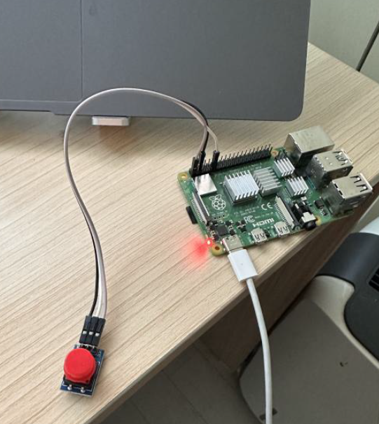

# kernel-interrupt-latency-test
A Linux device driver that prints Morse code via button interrupts, benchmarking the execution time of Threaded IRQ, Workqueue, and Tasklet.

### 1. Overview & Hardware Setup
- Raspberry Pi 4B
- Linux Kernel Version: 6.12.75 (6.12.XX)
- Trace Tool: ftrace function_graph
- Hardware Setup
  - GND: 6th pin or 9th pin
  - VCC / 3.3V: 1th pin
  - GPIO Signal: Raspberry Pi 4B GPIO 17 (40th pin)

- IRQ 57
  - BCM2835 SoC의 GPIO 핀 입력이 커널 내부에서 매핑된 인터럽트 번호로, `request_threaded_irq`를 통해 Top-Half 핸들러가 바인딩되어 버튼 입력을 비동기적으로 감지

### 2. System Architecture & Event Flow

### 3. Quantitative Benchmark Results

  #### 3-1. In-Depth Latency Analysis

  #### 3-2. Verification & Trace Logs
